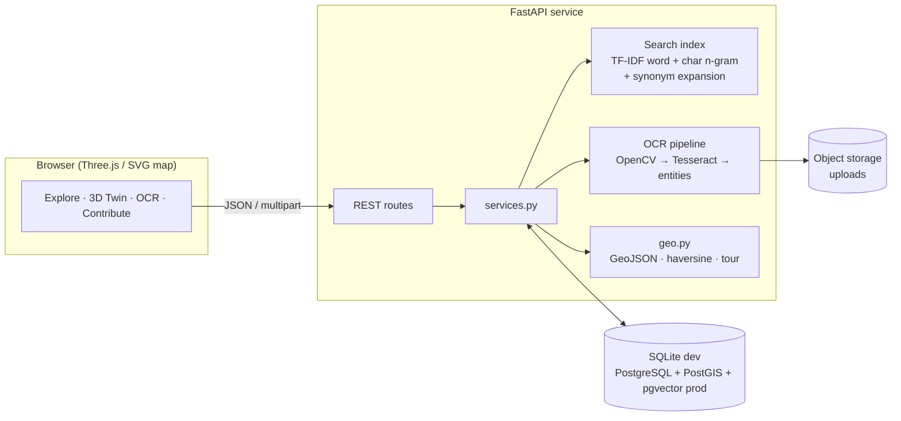
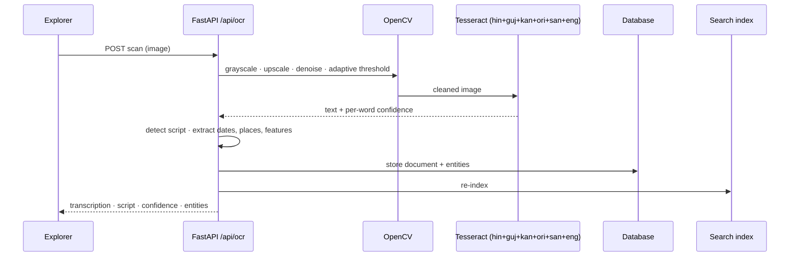
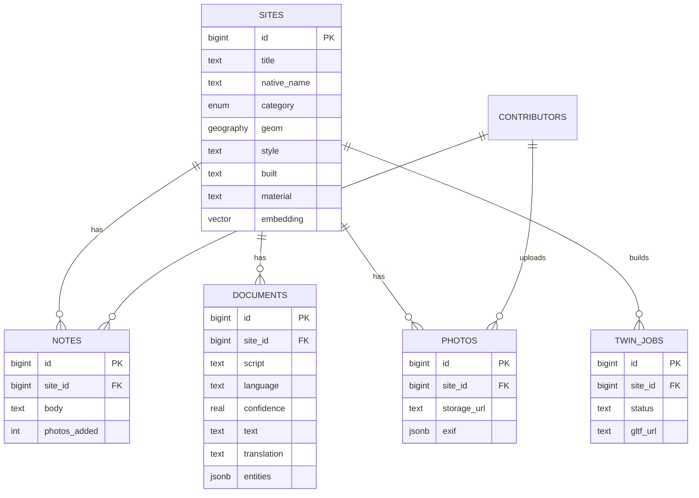

# Virasat — Living Heritage Archive

> HackCult '26 · Track 2 · **HC26-CULT01** — Digital Revitalisation of Unstructured Cultural & Architectural Heritage Archives

Field documentation (photos, regional-language notes, journals) usually ends up in slide decks and cloud folders
where nobody can search it. **Virasat** turns that material into a searchable, spatial, 3D-explorable and
OCR-digitised knowledge base. It combines all three pathways in the problem statement:

| Pathway | What Virasat does | Where |
|---|---|---|
| **Geospatial / immersive web** | Interactive India map with real state boundaries, pins, hover previews, click-to-zoom, animated explorer journey, nearby search | `frontend/`, `GET /api/geojson`, `/api/nearby`, `/api/journey` |
| **Archival NLP / OCR** | Upload a scan → OpenCV clean-up → Tesseract (Hindi, Gujarati, Kannada, Odia, Sanskrit) → script detection → date / place / feature extraction → searchable | `backend/app/ocr.py`, `POST /api/ocr` |
| **Computer vision / 3D** | WebGL (Three.js) 3D models per building type, fly-through camera; reconstruction pipeline designed (see roadmap) | `frontend/`, `twin_jobs` in `db/schema.sql` |

Plus: **hybrid search** across records, field notes and OCR'd text (English + Indic scripts, spelling variants such as *baoli / baori / vav*),
and a **contribute** flow so new field notes become searchable immediately.

---

## Architecture



### OCR → searchable text



### Data model



The full PostgreSQL DDL (PostGIS `geography`, `pgvector` HNSW index, `pg_trgm`, JSONB entities) is in
[`db/schema.sql`](db/schema.sql). The development build runs the same logical tables on SQLite so it needs no setup.

---

## Quick start

**Requirements:** Python 3.11+, Tesseract OCR with language packs.

```bash
# Ubuntu/Debian
sudo apt install tesseract-ocr tesseract-ocr-hin tesseract-ocr-guj tesseract-ocr-kan tesseract-ocr-ori tesseract-ocr-san
# macOS:  brew install tesseract tesseract-lang

cd backend
python -m venv .venv && source .venv/bin/activate      # Windows: .venv\Scripts\activate
pip install -r requirements.txt
uvicorn app.main:app --reload
```

Open **http://localhost:8000** (web app) and **http://localhost:8000/docs** (interactive API docs).
The database is created and seeded with 14 heritage records on first start.

**Docker:** `docker compose up --build` → http://localhost:8000

**Tests:**

```bash
cd backend
python -m unittest discover -s tests -v     # 20 service-layer tests + 7 HTTP tests (skipped if FastAPI isn't installed)
```

Configuration lives in environment variables — see [`.env.example`](.env.example).

## API

| Method & path | Purpose |
|---|---|
| `GET /api/sites` · `GET /api/sites/{id}` | List records · record with notes and OCR documents |
| `POST /api/sites` | Add a discovery (validated: India bounding box, category enum) |
| `POST /api/sites/{id}/notes` | Add a field note (+ photo count); instantly searchable |
| `GET /api/search?q=&category=&limit=` | Hybrid search, English and Indic scripts |
| `POST /api/ocr` (multipart `file`, optional `site_id`) | Digitise a scan |
| `GET /api/geojson` | All sites as a GeoJSON FeatureCollection |
| `GET /api/nearby?lat=&lon=&radius_km=` | Sites within a radius, sorted by distance |
| `GET /api/journey?start_id=` | Explorer tour (nearest-neighbour) with leg + total km |
| `GET /api/stats` · `GET /api/health` | Counts · liveness probe |

## Project structure

```
backend/app/   config · db · seed_data · search · ocr · geo · services · main (FastAPI)
backend/tests/ test_core.py (service layer) · test_api.py (HTTP)
db/schema.sql  PostgreSQL + PostGIS + pgvector production schema
frontend/      index.html (map, 3D, OCR, contribute) · api-bridge.js (wires UI to the API)
```

## Scalability

* **Stateless API** behind a load balancer; all state lives in the database and object storage, so replicas scale horizontally.
* **Postgres path:** `geography` + GiST for radius queries, `pgvector` HNSW for semantic search, `pg_trgm` for fuzzy text.
  Search moves from in-process TF-IDF to SQL + vectors (the `Embedder` hook in `search.py` is the seam).
* **Async workers:** OCR and 3D reconstruction are CPU/GPU heavy — move behind a queue (Celery/RQ) writing to `documents` / `twin_jobs`;
  the API returns a job id and the UI polls.
* **Media offload:** photos and glTF models to S3-compatible storage + CDN; the DB stores URLs only.
* **Map tiles & boundaries** are static assets, cacheable at the edge.

## Honest limitations

* **3D twins are procedural templates** (stepwell, temple, fort, palace, chariot, cave) built in Three.js. The photo → 3D
  reconstruction (COLMAP/SfM → mesh → glTF) is designed (`photos`, `twin_jobs`) but **not implemented** yet.
* **OCR** uses Tesseract; accuracy on degraded handwriting and manuscripts is limited. **Translation** is a hook
  (`ocr.translate`) with no provider configured, so `translation` is `null`.
* **Search** is lexical + character n-gram + synonym expansion, not neural; dense embeddings are a planned plug-in.
* Development database is **SQLite**; the PostgreSQL schema is provided but the running code does not use it yet.
* State boundaries in the web app are **simplified** (Douglas–Peucker) from the open dataset
  [Tanmay53/india-state-boundries-geojson](https://github.com/Tanmay53/india-state-boundries-geojson) (Apache-2.0).
* No authentication or moderation on contributions yet.

## Roadmap

1. COLMAP reconstruction worker + glTF viewer, fed by crowdsourced photos.
2. TrOCR / vision-transformer OCR for manuscripts; IndicTrans2 for translation.
3. Multilingual embeddings in pgvector for semantic search; image similarity search over photos.
4. Auth, contributor profiles, moderation queue, offline-first mobile capture for field trips.
5. Public exports (GeoJSON / IIIF) so archives can be reused by other institutions.

## Credits & license

Built for HackCult '26. Licensed under MIT (see `LICENSE`); third-party data is credited in `NOTICE`.
Heritage descriptions are short summaries written for this project.
